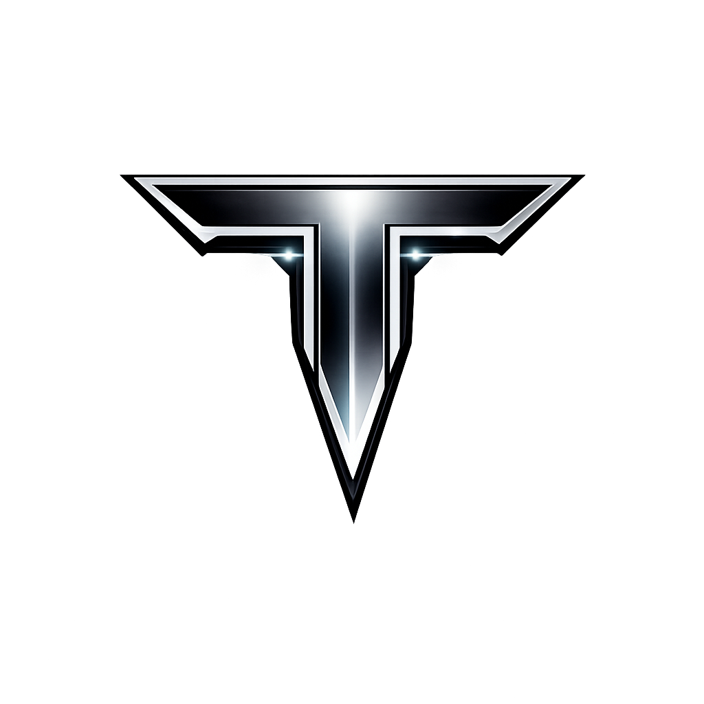

# Titan Launcher

The official launcher for **SWG: Titan** - a Star Wars Galaxies server.



**Developer documentation:** [docs/README.md](docs/README.md) (architecture, build/deploy, server administration). Also indexed from the monorepo [docs/README.md](../../docs/README.md).

## Table of Contents

- [System Requirements](#system-requirements)
- [Installation](#installation)
- [Getting Started](#getting-started)
- [Features](#features)
- [Troubleshooting](#troubleshooting)
- [For Server Administrators](#for-server-administrators)

---

## System Requirements

- **Operating System:** Windows 10/11 (64-bit)
- **Disk Space:** ~15 GB for full game installation
- **Internet:** Broadband connection required for download and play
- **Runtime:** .NET 9 runtime is bundled (no separate installation needed)

---

## Installation

1. **Download** the latest `Kaadu.exe` from the official release
2. **Run** `Kaadu.exe` - no installation required (portable executable)
3. The launcher will guide you through the rest of the setup

---

## Getting Started

### Step 1: First Launch - Select Installation Location

When you first run the launcher, you'll be asked to choose where to install the game files.

- **Default Location:** `C:\Users\Public\Titan\SWG\`
- Click **Browse...** to choose a custom location
- Click **Continue** to proceed

> **Tip:** Ensure you have at least 15 GB of free space on the selected drive.

### Step 2: Login

Enter your SWG: Titan account credentials:

- **Username:** Your registered account username
- **Password:** Your account password
- Click **LOGIN** to authenticate

> **Note:** Don't have an account? Visit [swgtitan.org](https://swgtitan.org) to register.

### Step 3: Game Download

If this is your first time, the launcher will automatically:

1. **Download** the base game files from the server
2. **Verify** all downloaded files for integrity
3. **Check for updates** and apply any patches

The progress bar shows download status. You can **Cancel** at any time - the launcher supports **resume**, so you won't lose progress!

### Step 4: Initial Setup

After the game downloads, you'll see the **Run Setup** button:

1. Click **⚙ Run Setup** to launch the game configuration tool
2. Configure your graphics settings, resolution, and other preferences
3. Close the setup window when finished

> **Important:** Run setup at least once before playing to configure DirectX and graphics options.

### Step 5: Play!

Once everything is ready, click the **PLAY** button to launch the game!

---

## Features

### Auto-Login
The launcher automatically logs you into the game server with your credentials - no need to enter them again in-game.

### Character Selection
If you have existing characters, you can select which character to auto-load from the dropdown menu before clicking Play.

### Automatic Updates
Every time you launch, the launcher checks for updates and downloads only the files that have changed.

### Resume Downloads
If your download is interrupted, simply restart the launcher. It will verify existing files and resume where it left off.

### Repair Game Files
If you experience issues, the launcher can verify and repair corrupted game files automatically.

---

## Launcher Interface

### Header Bar
- **Username Display** - Shows your logged-in account
- **📁 Directory** - Change game installation location
- **📋 Console** - Admin console (administrators only)
- **⚙ Admin** - Admin panel (administrators only)
- **Logout** - Sign out of your account

### Main Area
- **Status Message** - Shows current operation status
- **Progress Bar** - Displays download/update progress (when active)
- **Character Dropdown** - Select character for auto-login
- **PLAY Button** - Launch the game

### Footer
- Version information and links

---

## Troubleshooting

### "DirectX 9 not properly initialized"
This error typically means the game couldn't find its DirectX libraries.

**Solution:**
1. Run the **⚙ Run Setup** from the launcher
2. Ensure you're running the launcher as Administrator
3. Verify your graphics drivers are up to date

### Game won't launch
1. Make sure setup has been run at least once
2. Try running the launcher as Administrator
3. Check that antivirus isn't blocking the game executable
4. Use the **Check for Updates** button to verify files

### Download stuck or very slow
1. Check your internet connection
2. The server may be under heavy load - try again later
3. If stuck, cancel and restart - resume will pick up where it left off

### "Base game manifest not found"
The server's base game files aren't available. Contact server administrators.

### Login failed
1. Verify your username and password are correct
2. Check that your account is active at [swgtitan.org](https://swgtitan.org)
3. Ensure you have internet connectivity

### Files keep re-downloading
This may indicate corrupted local files. Try:
1. Deleting the `.base_installed` marker file in your game directory
2. Letting the launcher re-verify all files

---

## Changing Installation Location

To move your game to a different location:

1. Click **📁 Directory** in the header
2. Select the new installation path
3. The launcher will check if game files exist at the new location
4. If files don't exist, it will download them fresh

> **Note:** This doesn't move existing files - you'll need to manually move or re-download.

---

## For Server Administrators

### Admin Panel Access
Administrators with appropriate permissions will see the **⚙ Admin** button in the header. This provides access to:

- Manifest generation tools
- Server file management
- Update deployment

### Admin Console
The **📋 Console** button opens a command console for advanced server management operations.

### Generating Manifests

Use the `KaaduManifestGenerator` tool to create manifests:

```bash
# Generate base game manifest from local files
KaaduManifestGenerator local -d "C:\GameFiles" -v "1.0.0" -o base_manifest.json

# Generate manifest from SFTP server
KaaduManifestGenerator sftp -r "/sftp/sftpuser/upload/base/" -v "1.0.0" -u admin -p password
```

### Server File Structure

```
/sftp/sftpuser/upload/
├── base/                    # Base game files
│   ├── SwgClient_r.exe
│   ├── dpvs.dll
│   └── ...
├── updates/                 # Update/patch files
│   └── ...
├── config/
│   ├── base_manifest.json   # Base game file manifest
│   ├── update_manifest.json # Update file manifest
│   └── launcher.json        # Launcher version info
└── launcher/                # Launcher binaries
    └── {version}/
        └── Kaadu.exe
```

---

## Version History

- **1.0.1** - Current version
  - Manifest-based file downloads with resume support
  - DirectX 9 launch fixes
  - Improved progress tracking

---

## Support

- **Website:** [swgtitan.org](https://swgtitan.org)
- **Discord:** Join our community for help and updates

---

*May the Force be with you!*
