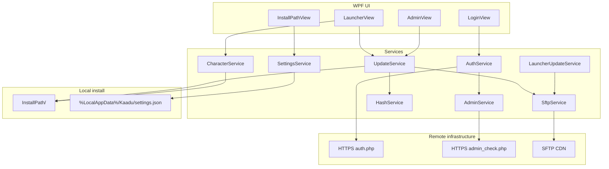

# Kaadu architecture

## Overview

Kaadu is a .NET 9 WPF application that orchestrates four concerns:

1. **Authentication** — HTTPS login against the Titan web API
2. **Content delivery** — SFTP manifest downloads with SHA-256 verification and resume
3. **Game launch** — spawn `SwgTitan_r.exe` with DirectX-friendly process settings and optional auto-login CLI args
4. **Self-update** — compare local launcher version against remote `launcher.json` and replace in place



## Solution projects

| Project | Output | Purpose |
|---------|--------|---------|
| `Kaadu/Kaadu.csproj` | `Kaadu.exe` | Player-facing launcher |
| `KaaduManifestGenerator/KaaduManifestGenerator.csproj` | `kaadu-manifest.exe` | Generate and verify JSON manifests |
| `Kaadu.Deploy/Kaadu.Deploy.csproj` | `Kaadu.Deploy.exe` | Upload published launcher to SFTP (not in `Kaadu.slnx`; build separately) |

Open `Kaadu.slnx` in Visual Studio 2022+ or build from the command line (see [build-and-deploy.md](build-and-deploy.md)).

## UI flow

Navigation is handled by `NavigationService` and wired in `MainWindow.xaml.cs`:

```
Startup
  → Load settings (%LocalAppData%/Kaadu/settings.json)
  → Check launcher self-update (LauncherUpdateService)
  → LoginView

Login success
  → If no custom install path → InstallPathView
  → Else → LauncherView

LauncherView (on load)
  → CheckAndUpdateAsync (base install + patches)
  → Load character list from game directory
  → Enable Play / Run Setup as appropriate
```

Views and view models:

| View | ViewModel | Notes |
|------|-----------|-------|
| `Views/LoginView.xaml` | `LoginViewModel` | Posts credentials to auth endpoint |
| `Views/InstallPathView.xaml` | `InstallPathViewModel` | First-run directory picker |
| `Views/LauncherView.xaml` | `LauncherViewModel` | Progress, Play, Setup, character dropdown |
| `Views/AdminView.xaml` | `AdminViewModel` | Force update, repair, manifest tools (admin only) |
| `Views/AdminConsoleWindow.xaml` | — | Admin command console |

`MainWindow` also hosts a system tray icon (`NotifyIcon`) with Play, Check for Updates, and character shortcuts.

## Service layer

Services are constructed manually in `MainWindow` (no DI container).

| Service | Interface | Responsibility |
|---------|-----------|----------------|
| `AuthService` | `IAuthService` | POST form login to `AppConfiguration.AuthUrl` |
| `AdminService` | `IAdminService` | Fetch admin level from `AppConfiguration.AdminCheckerUrl` |
| `SftpService` | `ISftpService` | SSH.NET file and text download/upload |
| `HashService` | `IHashService` | SHA-256 verify against manifest checksums |
| `UpdateService` | `IUpdateService` | Base install, patch sync, repair, game launch |
| `CharacterService` | `ICharacterService` | Parse `characterlist_{username}.txt` in install dir |
| `LauncherUpdateService` | `ILauncherUpdateService` | Remote `launcher.json` compare and self-update |
| `SettingsService` | `ISettingsService` | Persist install path, setup flag, mute state |

### Configuration constants

All remote URLs and SFTP paths are centralized in `Kaadu/Models/AppConfiguration.cs`:

- `AuthUrl`, `AdminCheckerUrl`, `GameLoginServerAddress`
- `SftpHost`, `SftpPort`, `SftpBasePath`
- `BaseGamePath`, `UpdatesPath`, `ConfigPath`
- Manifest file names: `base_manifest.json`, `update_manifest.json`, `launcher.json`

Change these constants (or refactor to config file) when pointing at a different shard or staging CDN.

## Update pipeline

### Two-stage install model

1. **Base game** — files listed in `config/base_manifest.json`, stored under SFTP `base/`
2. **Patches** — files listed in `config/update_manifest.json`, stored under SFTP `updates/`

Local state:

| File | Meaning |
|------|---------|
| `.base_installed` | Base manifest fully verified; marker timestamp written on success |
| `version.json` | `{ "version": "<latest_version from update manifest>" }` |

### CheckAndUpdateAsync logic (`UpdateService.cs`)

```
If .base_installed missing
  → InstallBaseGameAsync (download base/ files, verify hashes, write marker)

Fetch update_manifest.json
If manifest unavailable
  → Ready (offline / CDN down)

If local version == manifest.latest_version
  → Verify all listed files; download any missing or hash-mismatch
Else
  → Download all files needing update

Save version.json
→ Ready
```

Downloads support **resume**: existing files with matching SHA-256 are skipped.

### Repair

`RepairGameAsync` re-verifies every file in the update manifest and re-downloads failures. Exposed in the admin panel and launcher UI.

## Game launch

### Standard launch

```csharp
ProcessStartInfo {
  FileName = "{InstallPath}/SwgTitan_r.exe",
  WorkingDirectory = InstallPath,
  UseShellExecute = false   // Required for D3D9 init
}
```

### Auto-login launch

When the session has stored credentials, Kaadu passes SWG client CLI options:

```
--launched -- -s ClientGame
  loginServerAddress={server}
  loginServerPort=44453
  launcherAvatarName={character}    // optional
  loginClientID={username}
  loginClientPassword={password}
  autoConnectToLoginServer=true
  -s Station gameFeatures=34929
  -s SwgTitan allowMultipleInstances=true
```

Password on the command line matches legacy SWG launcher behavior; it may be visible in process listings.

### First-run setup

`SwgTitanSetup_r.exe` is launched with `UseShellExecute = true`. The `HasRunSetup` flag in user settings gates the **Run Setup** button vs **Play**.

## Character list

After setup, the game writes `characterlist_{username}.txt` in the install directory (CSV lines: `server,characterName,...`). Kaadu reads this for the character dropdown and passes `launcherAvatarName` on Play.

## Authentication

`AuthService` POSTs `application/x-www-form-urlencoded` fields:

- `user_name`, `user_password`, `secretKey` (hardcoded in source)

On success, `UserSession` stores username, password (for auto-login), server address, and admin level.

Admin UI (`AdminView`, `AdminConsoleWindow`) is visible when `UserSession.IsAdmin` is true.

## Launcher self-update

On startup, `LauncherUpdateService`:

1. Downloads `config/launcher.json`
2. Compares semver to `AppConfiguration.LauncherVersion`
3. If newer (or below `minimum_version`), prompts the user
4. Downloads from `launcher/v{version}/` on SFTP and runs a replace script

Deploy new launcher builds with `Kaadu.Deploy` (see [build-and-deploy.md](build-and-deploy.md)).

## Key dependencies

| Package | Use |
|---------|-----|
| `CommunityToolkit.Mvvm` | `[ObservableProperty]`, `[RelayCommand]` |
| `SSH.NET` | SFTP client |

Kaadu also references `UseWindowsForms` for the tray icon and folder browser dialogs.

## Theming

WPF resource dictionaries under `Kaadu/Themes/`:

- `Colors.xaml`, `ButtonStyles.xaml`, `ControlStyles.xaml`, `TextStyles.xaml`
